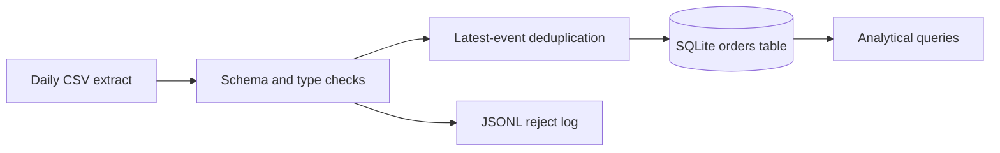

# Python Incremental ETL — Orders to SQLite

**Category:** ETL design, data contracts, incremental ingestion, reliability  
**Tools:** Python 3.10+, CSV, SQLite, `unittest`; zero third-party dependencies

## Business problem

A retailer sends daily extracts of orders. Files may include duplicate events, invalid amounts, stale updates, and new records. The warehouse must retain the **latest valid version** of each order without creating duplicates on reruns.

## Pipeline design



**Rules:**

- Validate columns, dates, amount (`Decimal`, stored as integer cents), status and required identifiers.
- Keep the latest timestamp per `order_id` within each extract.
- Apply an update only when its `updated_at` is **newer** than the stored version.
- Use a unique primary key on `order_id` and one database transaction per batch.
- Write invalid rows to a JSONL rejects report; return a metrics summary.

## Run

```bash
python pipeline.py --input data/orders_day1.csv --database orders.db --rejects rejects_day1.jsonl
python pipeline.py --input data/orders_day2.csv --database orders.db --rejects rejects_day2.jsonl
python pipeline.py --input data/orders_day2.csv --database orders.db --rejects rejects_repeat.jsonl
python -m unittest discover -s tests -v
```

Replaying `orders_day2.csv` is idempotent: no rows are inserted or updated on the second run. Query results with:

```bash
python -c "import sqlite3; c=sqlite3.connect('orders.db'); print(c.execute('SELECT * FROM orders ORDER BY order_id').fetchall())"
```

## Caveats and production extensions

This demonstration uses synthetic data and a single-process local SQLite database. The pipeline rejects files whose header is missing required columns. It has row-level validation and transaction-safe upserts, but **does not** handle schema migrations, multi-worker concurrency, external transaction coordination, PII governance, or cloud secrets. Reject-log writes are not transactional with the database. For production, add structured metrics, file-level checksums, orchestration, recovery from partial external writes, schema contracts, and monitoring.

## What to explain in interviews

- Why an `updated_at` watermark is preferable to blind overwrites.
- Difference between duplicate records in a batch and historical updates.
- Why `Decimal` should be used for money.
- How you'd migrate the pipeline to S3/ADLS + Delta Lake MERGE.
